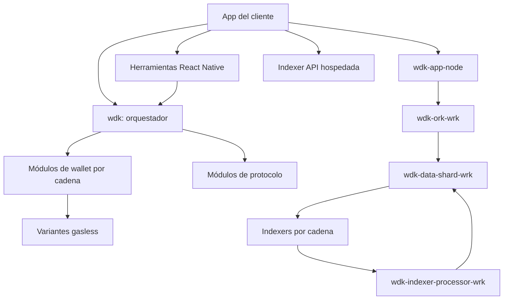

# WDK — visión de arquitectura

Punto de entrada para quien trabaja con el WDK de Tether. La fuente de verdad de cada afirmación son `wdk-docs` y los repos del workspace; de cada decisión, su nodo en `decisions/`: este documento solo los conecta. Para el vault en sí, ver [[00-START-HERE]]; para el índice de todo, [[MOC WDK]].

## Qué es el WDK

El WDK (Wallet Development Kit) es un toolkit open source y autocustodial para construir billeteras: la app aporta la seed y cada módulo deriva de ella las claves de su cadena, sin custodio intermediario (ver [[Diseñar el WDK como autocustodial sin custodio intermediario]] y [[Seed derivada en el dispositivo]]). Alrededor de ese núcleo hay módulos de protocolo (swap, bridge, fiat, lending, precios), variantes gasless, herramientas de React Native, un stack de backend e indexado y herramientas de IA y CLI. Este vault lo usa SpaceDev como socio de implementación con dos preguntas: si un servicio que un cliente ya paga puede reemplazarse con un módulo WDK (ver `auditoria/PROCEDIMIENTO.md`), y si algo es posible con la versión instalada.

Dos reglas gobiernan todo lo demás. La primera, de diseño: [[La seed nunca sale del dispositivo]]. La segunda, de método: [[Verificar la versión antes de afirmar una capacidad]], porque lo que la doc describe puede no existir en la versión instalada ([[Versión documentada vs versión instalada]]).

## Mapa de sistemas



- **Núcleo y wallets por cadena**: [[wdk]] orquesta, [[wdk-wallet]] define las interfaces base y cada cadena tiene su módulo (por ejemplo [[wdk-wallet-evm]] y [[wdk-wallet-tron]]). Mapa: [[MOC Billetera self-custodial]].
- **Gasless**: variantes por cadena que permiten transferir sin el token nativo, todas con un tercero que cubre el fee ([[Gasless requiere paymaster configurado]]). Mapa: [[MOC Gasless]].
- **Protocolos**: swap, bridge, swidge, fiat, lending, depósitos y precios, que operan sobre una cuenta de wallet. Mapa: [[MOC Protocolos]].
- **Backend e indexado**: la solicitud va de [[wdk-app-node]] a [[wdk-ork-wrk]] y a [[wdk-data-shard-wrk]], que consulta a los indexers; [[wdk-indexer-processor-wrk]] enruta las transferencias a cada shard. La alternativa hospedada es la [[Indexer API]]. Mapa: [[MOC Backend e indexado]].
- **Caso SpaceUY**: [[wdk-qualification-exercise]] consume el stack completo.
- **Catálogo**: todos los módulos documentados, por área, en [[MOC Catálogo WDK]].

## Vocabulario

| Término | Significado en este vault | Ver |
| --- | --- | --- |
| Módulo | Paquete del WDK (`system`) que se registra en el orquestador o se usa solo | [[MOC Catálogo WDK]] |
| Módulo comunitario | Módulo que mantiene un tercero y que Tether no respalda; su nota va con `status: draft` | sección «Lo diseñado pero no vivo» de este documento |
| Seed | Semilla BIP-39 de la que se derivan todas las cuentas; el único activo que hay que proteger y respaldar | [[Seed derivada en el dispositivo]] |
| Paymaster | Tercero que cubre o cobra el fee de una transacción en lugar del usuario | [[Paymaster]] |
| Bundler | Servicio que recibe las `UserOperation` ERC-4337 y las incluye en cadena | [[Bundler ERC-4337]] |
| GasFree | Servicio de TRON que cumple el rol del paymaster en esa cadena | [[Cargo de activación de la cuenta GasFree]] |
| Ork y data shard | Directorio de shards y capa de persistencia por shard del backend de billeteras | [[wdk-ork-wrk]], [[Data shard por usuario]] |
| Servicio de mercado | Categoría de proveedor externo que un proyecto ya usa y un módulo WDK podría reemplazar | `services/`, relación `can replace` en `_meta/relations.md` |
| `detect:` | Lista de paquetes o dominios con los que se reconoce un servicio de mercado en el código de un proyecto | `auditoria/PROCEDIMIENTO.md` |
| Versión documentada | La que describe la doc de un módulo; puede diferir de la instalada y de la `latest` de npm | [[Versión documentada vs versión instalada]] |
| Versión desplegada | Última release de Tether integrada en `origin/main` de SpaceUY | [[Usar la release integrada en SpaceUY como versión desplegada]] |

## Las decisiones, conectadas

El vault registra dos decisiones, y cada una establece una restricción que ordena una espina.

- **Autocustodia.** [[Diseñar el WDK como autocustodial sin custodio intermediario]] establece [[La seed nunca sale del dispositivo]]. Esa restricción prohíbe [[Fuga de seed por almacenamiento inseguro]], y las herramientas del SDK la mitigan; el riesgo hermano, [[Pérdida de fondos por seed sin backup]], se mitiga con respaldo, y [[backup-cloud no cifra: la app cifra antes]] fija quién cifra ese respaldo. Contraste de mercado: [[Custodia tercerizada (MPC)]] y [[Wallets embebidas WaaS]] delegan las claves, y migrar a WDK traslada esa responsabilidad a la app.
- **Versión desplegada.** [[Usar la release integrada en SpaceUY como versión desplegada]] establece [[Verificar la versión antes de afirmar una capacidad]], que previene [[Usar una API documentada que mi versión no tiene]] y mitiga [[Breaking change entre betas]]. El procedimiento operativo es la sección «¿Puedo hacer X con mi versión?» de `CLAUDE.md`.

Las demás espinas no nacen de una decisión modelada sino de restricciones de los propios módulos: [[Gasless requiere paymaster configurado]] y [[Capability del handshake ork debe coincidir]].

## Lo diseñado pero no vivo

Esta sección se calcula con el `status` real del frontmatter, no de memoria. Comando, desde la raíz del vault:

```sh
grep -rlE '^status: (proposed|draft|built-off-by-default)' --include='*.md' concepts constraints failures decisions systems services MOC
```

Al 2026-10-26 el resultado es de 5 notas, todas `draft`; no hay ninguna `proposed` ni `built-off-by-default` (tampoco `todo` ni `superseded`). `draft` marca un módulo comunitario cuya madurez no está clara, no algo inexistente. Ninguna de estas notas debe citarse como capacidad lista para producción:

- [[wdk-wallet-cosmos]]: cadenas Cosmos.
- [[wdk-wallet-rgb]]: activos RGB sobre Bitcoin.
- [[wdk-rgb-lightning]]: nodo Lightning con RGB.
- [[wdk-wallet-evm-bermuda]]: cuentas blindadas de Bermuda en EVM.
- [[wdk-wallet-evm-x402-facilitator]]: facilitator x402 autoalojado.

Si el comando devuelve notas nuevas o distintas, esta lista quedó vieja y hay que actualizarla.

**Limitación del vault: los upstream de Tether son privados.** Los repos de backend (`wdk-app-node` y sus hermanos) son privados para esta cuenta, así que no se puede saber si Tether publicó una release más nueva que la integrada en `origin/main` de SpaceUY. Por eso «versión desplegada» significa la última release integrada allí, y todo lo que el vault dice sobre esos repos vale hasta esa release (ver [[Usar la release integrada en SpaceUY como versión desplegada]] y `_meta/last-sync.md`). Para los paquetes públicos sí se compara con la `latest` de npm en `_meta/versions.md`.

## Profundizar

- Mapas por espina: [[MOC Billetera self-custodial]], [[MOC Gasless]], [[MOC Backend e indexado]], [[MOC Protocolos]].
- Catálogo completo: [[MOC Catálogo WDK]]. Versiones y qué cambió entre ellas: [[MOC Versiones]] y `_meta/versions.md`.
- Auditar un proyecto de cliente: `auditoria/PROCEDIMIENTO.md` y `auditoria/plantilla-informe.md`.
- Disciplina de reemplazo: una decisión que reemplaza a otra se escribe como nota nueva con la relación `supersedes` hacia la anterior, cuyo `status` pasa a `superseded`; nunca se reescribe una decisión vigente en su lugar. Los cambios de las fuentes se incorporan con la skill `updating-typed-knowledge-vaults`.
